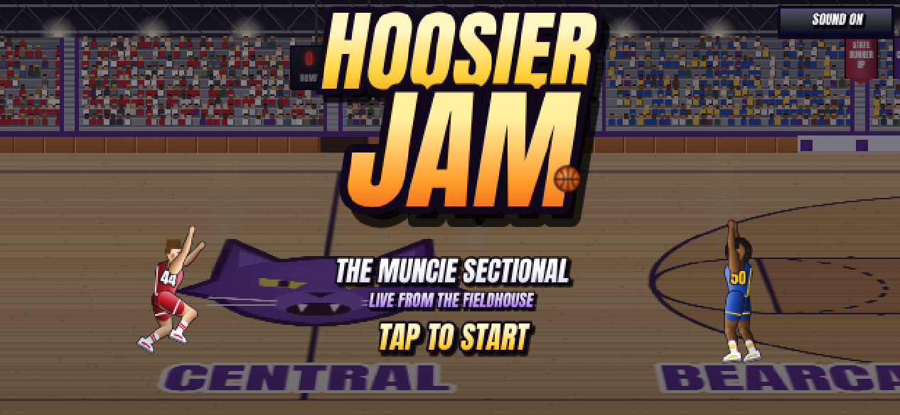
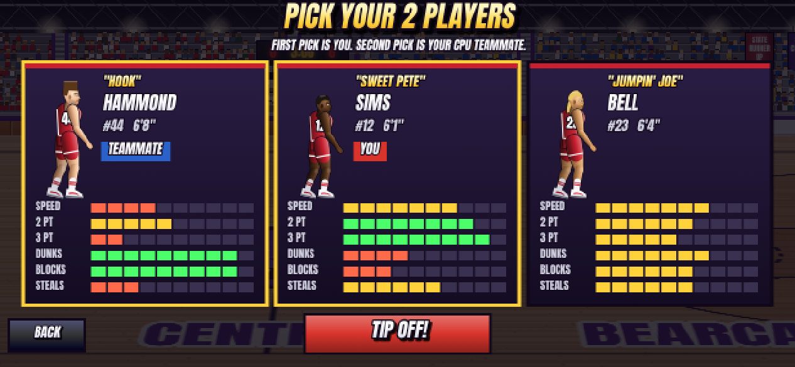
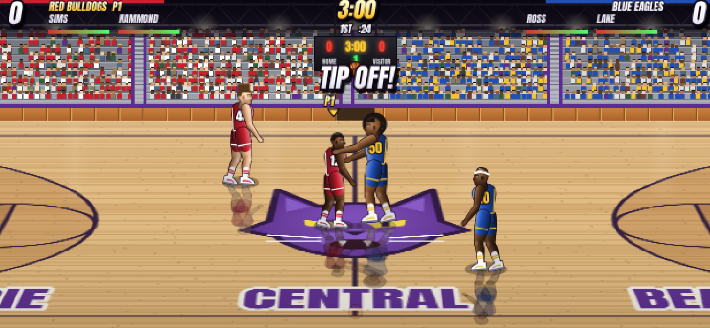
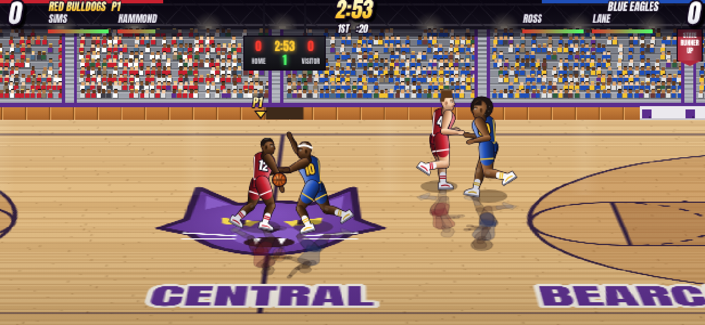
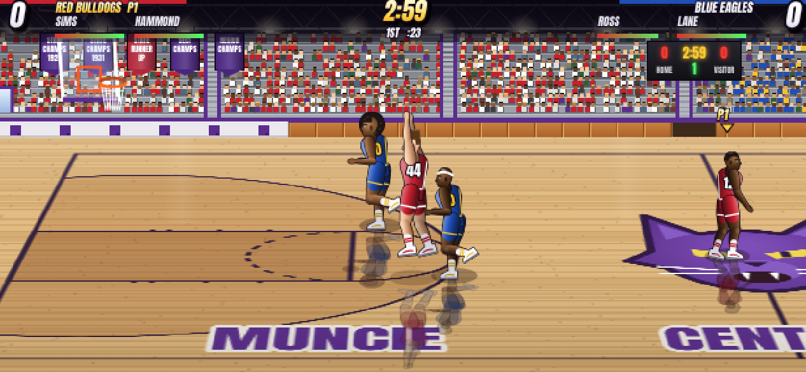
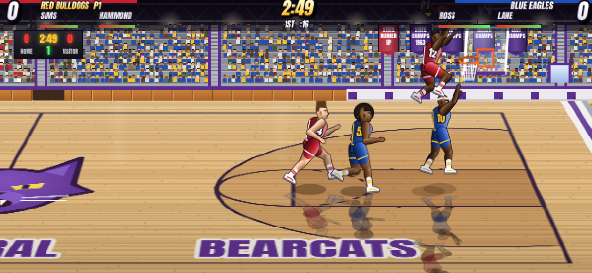
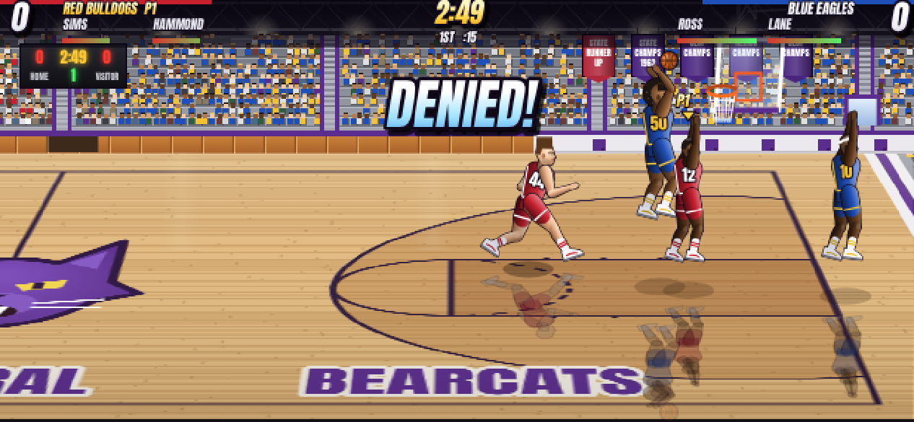
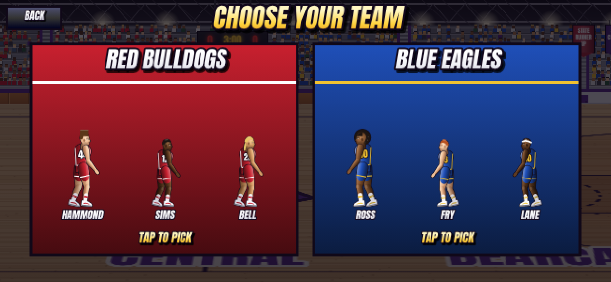
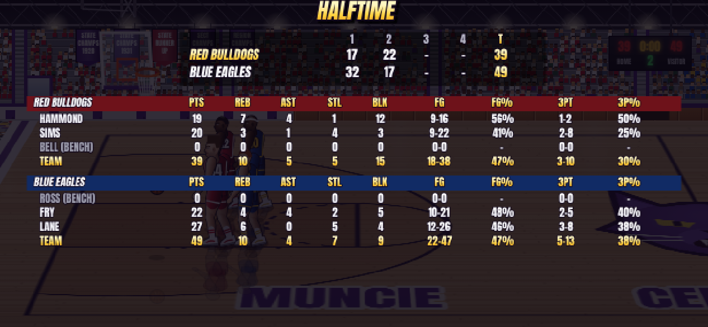

# Hoosier Jam

> **Work in progress.** Hoosier Jam is still being built. The teams on the court right now are placeholders, and the controls, art and balance are still changing.

A two-on-two arcade basketball game for your phone, styled after 1993 arcade NBA Jam and set at the height of Hoosier Hysteria. Every game tips off at the Muncie Sectional in the Muncie Fieldhouse, with big dunks, a red-hot shooter or two, and a crowd that comes unglued.

**Play it:** https://andyshearsphd.github.io/Hoosier-Jam/ (built for phones in landscape)

## How it works

- Pick a team, then pick two of its three players. Your first pick is you, and your second pick is your CPU teammate. You can sub at halftime.
- Four 3-minute quarters on a high school length court, a 24-second shot clock, and overtime if it's tied.
- Hold SHOOT to rise and let go at the top of your jump for your best shot. Let go too early or too late and it probably won't fall.
- Hold TURBO and hit SHOOT near the rim to dunk. Long dunks can spin.
- On defense, swipe for steals, jump to block, or hold TURBO and hit STEAL to shove.
- Make three in a row and you're red hot.
- After every quarter you get a box score and the score by quarter.

## Controls

**Phone (landscape)**
- Left thumb: a joystick appears wherever you touch
- Right thumb: SHOOT, PASS and TURBO. Slide from TURBO onto SHOOT to dunk with one thumb.
- When your teammate has the ball, PASS becomes CALL to ask for it, and SHOOT tells him to shoot
- PAUSE button at the bottom, or tap the game clock. The pause menu has Resume, Sound and Exit to Title.

**Keyboard**
- Arrow keys or WASD: move
- Space or J: shoot or jump
- K: pass or steal
- Shift or L: turbo
- P or Esc: pause

**Full screen on iPhone:** Safari won't hide its address bar on a regular web page. Open the game in Safari, tap Share, then Add to Home Screen, and launch Hoosier Jam from your home screen. It opens full screen with no browser bar.

## Features

- The Muncie Fieldhouse: maple floor with MUNCIE CENTRAL BEARCATS on the sideline and a Bearcat at center court, steep bleachers on every side, purple banners, steel trusses and a live hanging scoreboard
- Glossy floor with player reflections, and a crowd that jumps on big plays
- Shaded, animated players with their own builds, hair and looks
- Ratings for speed, two-pointers, threes, dunks, blocks and steals
- Box scores with points, rebounds, assists, steals, blocks, field goals and threes
- A CPU that eases off when it gets too far ahead, like the arcade did
- Arcade callouts and synthesized sound effects

## Screenshots

| | |
|---|---|
|  |  |
| Pick your two players | Tip-off at center court |
|  |  |
| Working the ball at center court | Battling in the paint |
|  |  |
| Going up for the dunk | Denied at the rim |
|  |  |
| Choose your team | Halftime box score |

## Coming next

- Delaware County schools and their three best players all-time
- A full sectional bracket

## Notes

No libraries and no build step. All graphics and sound are generated in code, and the only outside file is the Anton font (SIL Open Font License, in `fonts/`).

The Red Bulldogs and Blue Eagles and their players are fictional placeholders. The Bearcat at center court is an original drawing, not the school's logo. This is a fan-made tribute and is not affiliated with the NBA, Midway, Muncie Central or the IHSAA.
